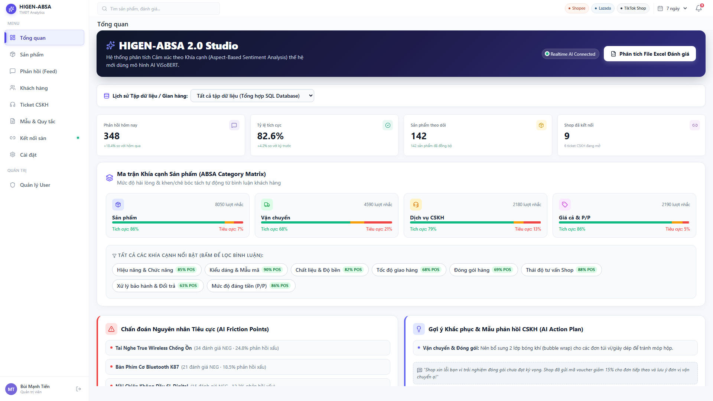
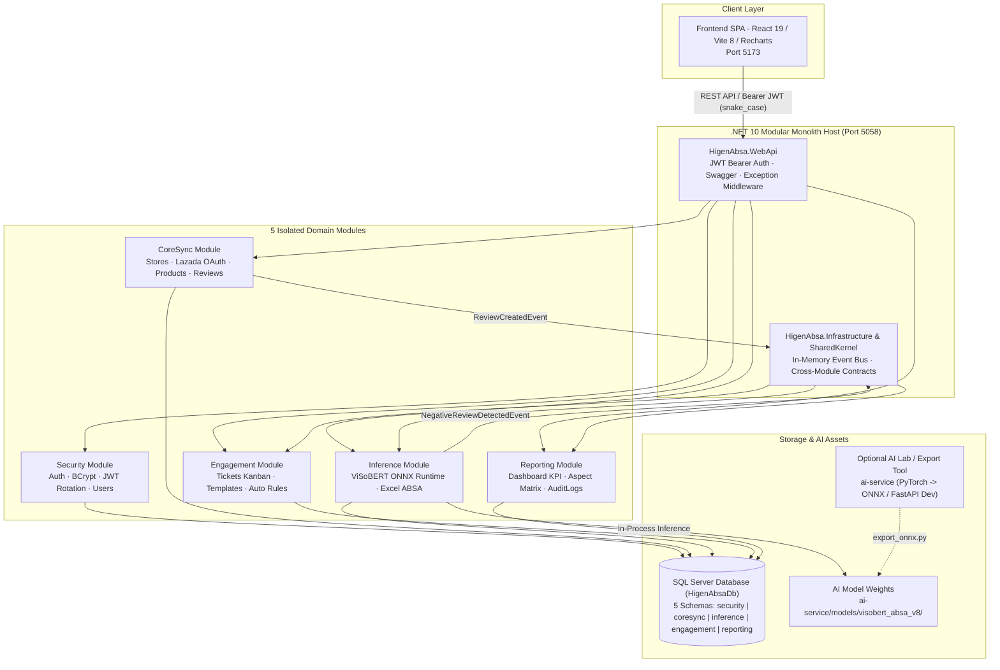
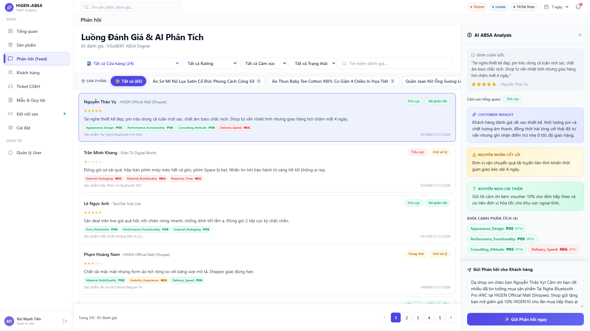
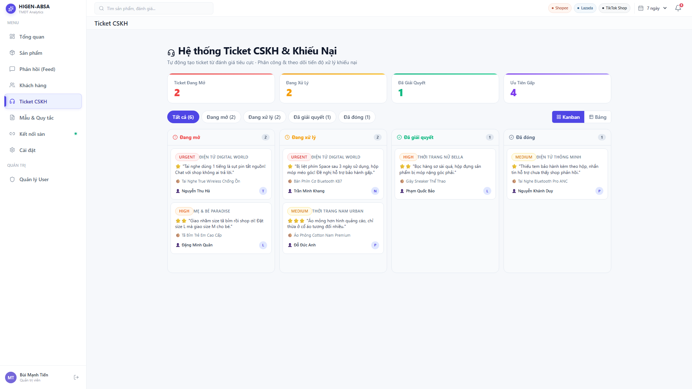
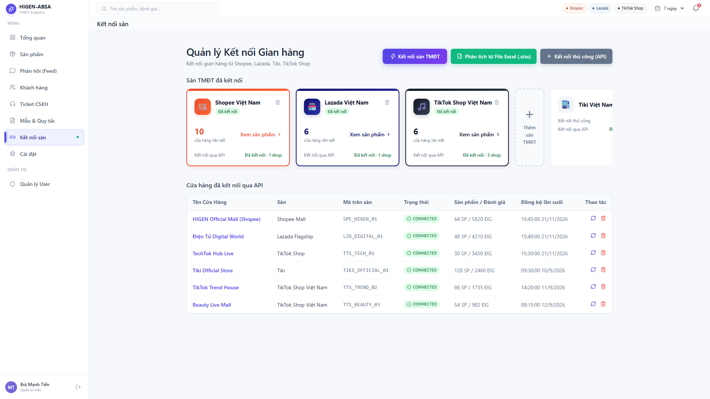
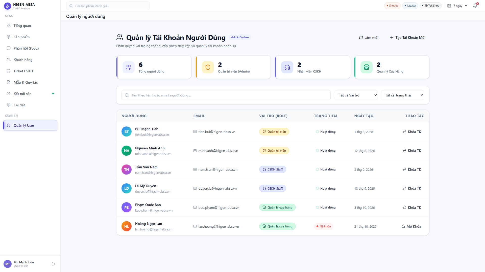

# HIGEN-ABSA: Hệ Thống Phân Tích Cảm Xúc Phân Cấp & Quản Lý Phản Hồi E-Commerce Bằng AI



*Giao diện **Tổng quan (HIGEN-ABSA 2.0 Studio)** hiển thị KPI thời gian thực, Ma trận Khía cạnh Macro/Micro (ABSA Category Matrix), Chẩn đoán nguyên nhân tiêu cực và Đề xuất hành động CSKH.*

---

## 1. GIỚI THIỆU TỔNG QUAN

**HIGEN-ABSA** (**H**ierarchical **I**nsight **G**eneration for **E**-commerce **N**atural Language - **A**spect-**B**ased **S**entiment **A**nalysis) là hệ thống Enterprise AI hỗ trợ tổng hợp, bóc tách cảm xúc theo khía cạnh và xử lý phản hồi khách hàng đa sàn Thương mại Điện tử tại Việt Nam (**Shopee**, **Lazada**, **Tiki**, **TikTok Shop**).

### 🎯 Các Tính Năng Nổi Bật
1. **Suy luận trực tiếp trên C# ONNX Runtime**:
   - Triển khai mô hình đa nhiệm **ViSoBERT-ABSA** (`best_model.onnx`) cùng bộ mã hóa **SentencePiece Unigram Tokenizer** (`ViSoBertTokenizer`) chạy trực tiếp bên trong Host `.NET 10 WebApi`, không phụ thuộc Python runtime ở môi trường vận hành.
2. **Phân tích Cảm xúc Phân cấp (Hierarchical ABSA)**:
   - Tự động nhận diện 5 nhóm khía cạnh lớn (**Macro**: `PRODUCT`, `SHIPPING`, `SERVICE`, `PRICE`, `OTHERS`) cùng 17 khía cạnh chi tiết (**Micro**: `Performance_Functionality`, `Appearance_Design`, `Delivery_Speed`, `External_Packaging`, `AfterSales_Complaint`, v.v.) và bộ quy tắc điều chỉnh miền thương mại điện tử (`DomainOverrides`).
3. **Sinh Insight & Khuyến nghị Hành động (Insight Engine)**:
   - Tổng hợp **Cảm nhận khách hàng** (*Customer Insight*), **Nguyên nhân cốt lõi** (*Root Cause*), **Khuyến nghị cải thiện** (*Business Recommendation*) và **Câu phản hồi gợi ý** (*Suggested Seller Response*) cho từng đánh giá hoặc từng tệp Excel/CSV tải lên hàng loạt.
4. **Kiến trúc Modular Monolith 5 Module & In-Memory Event Bus**:
   - Backend `.NET 10` tách biệt 5 module nghiệp vụ độc lập (`Security`, `CoreSync`, `Inference`, `Engagement`, `Reporting`), giao tiếp bất đồng bộ qua `InMemoryEventBus` và cô lập hoàn toàn dữ liệu theo **5 Schema / 16 Bảng SQL Server**.
5. **Tự động hóa CSKH & Bảo mật Enterprise Auth**:
   - Ghi nhận phản hồi tiêu cực để khởi tạo **Ticket CSKH** (Kanban 4 trạng thái), quản lý mẫu phản hồi/quy tắc tự động, băm mật khẩu chuẩn **BCrypt**, cấp phát **JWT Access Token + Refresh Token Rotation** và phân quyền RBAC (`ADMIN`, `CSKH_STAFF`, `STORE_MANAGER`).

---

## 2. KIẾN TRÚC HỆ THỐNG (MODULAR MONOLITH)

Hệ thống được thiết kế theo mô hình **Modular Monolith** trên `.NET 10`: một tiến trình triển khai duy nhất (`HigenAbsa.WebApi`) nhưng phân tách chặt chẽ ranh giới nghiệp vụ, `DbContext` và Database Schema giữa 5 Module:



---

## 3. CẤU TRÚC THƯ MỤC DỰ ÁN

```text
ABSA_App/
├── backend-dotnet/                                   # Core Backend (.NET 10 Modular Monolith)
│   ├── HigenAbsa.slnx                                # Solution quản lý toàn bộ Host, Shared, Modules & Tests
│   ├── Dockerfile
│   ├── database/
│   │   └── 01_init_schemas_and_tables.sql            # Script khởi tạo 5 Schema, 16 bảng & dữ liệu mẫu ban đầu
│   ├── src/
│   │   ├── Host/HigenAbsa.WebApi/                    # Điểm vào API: Program.cs, Middleware, appsettings.json
│   │   ├── Shared/HigenAbsa.SharedKernel/            # BaseEntity, Result/PagedResult, Contracts, IntegrationEvents
│   │   ├── Infrastructure/HigenAbsa.Infrastructure/  # InMemoryEventBus triển khai cơ chế Pub/Sub nội bộ
│   │   └── Modules/
│   │       ├── Security/HigenAbsa.Modules.Security/        # Schema [security]: Auth, JWT, SystemUsers, RefreshTokens
│   │       ├── CoreSync/HigenAbsa.Modules.CoreSync/        # Schema [coresync]: Platforms, Stores, Products, Customers, Reviews
│   │       ├── Inference/HigenAbsa.Modules.Inference/      # Schema [inference]: ONNX Engine, ViSoBertTokenizer, ExcelAnalysis
│   │       ├── Engagement/HigenAbsa.Modules.Engagement/    # Schema [engagement]: Tickets, ResponseTemplates, AutomationRules
│   │       └── Reporting/HigenAbsa.Modules.Reporting/      # Schema [reporting]: Dashboard KPI, AuditLogs, DailySummaries
│   └── tests/HigenAbsa.UnitTests/                    # Kiểm thử Backend 100% trên RAM (xUnit + EF InMemory + Moq)
│       └── Modules/Security/                         # Cấu trúc chuẩn SOTA 3 ngăn
│           ├── Specs/                                # Đặc tả chuẩn ISO/IEC/IEEE 29119-3
│           ├── Fixtures/                             # Ngữ cảnh InMemoryDbContext & Seed giả lập cô lập trên RAM
│           └── Services/                             # 15 Unit/Service Tests (Auth, Account, JWT)
├── frontend/                                         # Giao diện SPA React 19 + Vite 8 + Tailwind CSS v4
│   ├── src/
│   │   ├── components/                               # AspectMatrix, AiInsightCard, ExcelUploadModal, Layout
│   │   ├── context/                                  # AuthContext & Quản lý phiên JWT
│   │   ├── data/                                     # Dữ liệu mô phỏng đa sàn Shopee / Lazada / TikTok Shop
│   │   ├── pages/                                    # Overview, ReviewFeed, Tickets, Connect, Users, Templates...
│   │   ├── services/                                 # apiClient (auto Bearer Token) & service modules
│   │   └── utils/                                    # aspectMapper (ánh xạ nhãn Macro/Micro tiếng Việt)
│   ├── tests/                                        # Kiểm thử Frontend 100% trên RAM (Vitest + RTL + JSDOM)
│   │   ├── setup.js
│   │   └── modules/security/                         # Cấu trúc đối xứng 3 ngăn
│   │       ├── specs/                                # Đặc tả kiểm thử Frontend chuẩn ISO/IEC/IEEE 29119-3
│   │       ├── fixtures/                             # renderWithAuthRouter(), mockFetchOk(), mockFetchError()
│   │       └── suites/                               # 10 Test Cases tự động (Login, Register, Session, RBAC Users)
│   ├── package.json
│   └── vite.config.js
├── ai-service/                                       # Pipeline mô hình học sâu & Export ONNX
│   ├── app/                                          # API FastAPI dev (api, core, data)
│   ├── models/visobert_absa_v8/                      # Trọng số ONNX (best_model.onnx) & Tokenizer
│   ├── scripts/
│   ├── export_onnx.py                                # Script chuyển đổi PyTorch MultiTaskABSA -> ONNX (opset 14)
│   ├── requirements.txt
│   └── run.py
├── docs/images/                                      # Ảnh chụp giao diện chuẩn FullHD (1920x1080) phục vụ tài liệu
└── README.md
```

---

## 4. CƠ SỞ DỮ LIỆU SQL SERVER (5-SCHEMA MODULAR ISOLATION)

Cơ sở dữ liệu `HigenAbsaDb` gồm **16 bảng** chia vào **5 schema** tách biệt quyền sở hữu dữ liệu theo từng Module (`backend-dotnet/database/01_init_schemas_and_tables.sql`):

| Schema | Module sở hữu | Danh sách Bảng | Vai trò nghiệp vụ |
| :--- | :--- | :--- | :--- |
| **`security`** | `Modules.Security` | `SystemUsers`, `RefreshTokens` | Tài khoản hệ thống, mật khẩu BCrypt, phân quyền RBAC và xoay vòng Refresh Token. |
| **`coresync`** | `Modules.CoreSync` | `Platforms`, `StoreConnections`, `Products`, `Customers`, `Reviews` | Sàn TMĐT, gian hàng kết nối, danh mục sản phẩm, khách hàng và bình luận thô. |
| **`inference`** | `Modules.Inference` | `ReviewAIAnalysis`, `ReviewAspects`, `ReviewKeywords` | Cảm xúc tổng quan, Insight tự sinh, Bằng chứng (`EvidenceText`/`Start`/`End`), Khía cạnh Macro/Micro & Từ khóa. |
| **`engagement`** | `Modules.Engagement` | `ResponseTemplates`, `AutomationRules`, `ReviewResponses`, `Tickets` | Mẫu trả lời, luật phản hồi tự động, lịch sử phản hồi và Ticket CSKH xử lý khiếu nại. |
| **`reporting`** | `Modules.Reporting` | `AuditLogs`, `DailyPlatformSummaries` | Nhật ký truy vết thao tác hệ thống và bảng tổng hợp chỉ số theo ngày/sàn. |

---

## 5. HƯỚNG DẪN KHỞI CHẠY (GETTING STARTED)

### Yêu cầu tiền đề (Prerequisites)
- **.NET SDK**: Version `10.0` trở lên.
- **Node.js**: Version `20.x` trở lên (`npm` v10+).
- **SQL Server**: SQL Server LocalDB (`(localdb)\MSSQLLocalDB`) hoặc SQL Server 2019/2022 Express.
- **Python (Tùy chọn)**: `3.10+` — chỉ cần khi muốn chạy dịch vụ `ai-service` thử nghiệm hoặc re-export model PyTorch sang ONNX.

### Bước 1: Clone Repository
```bash
git clone https://github.com/BuiManhTien-vono/ABSA_App.git
cd ABSA_App
```

### Bước 2: Khởi tạo SQL Server 5-Schema & Chạy Backend `.NET 10`
Chạy script SQL để tạo database `HigenAbsaDb` với 5 schema, 16 bảng và tài khoản mẫu (mật khẩu mặc định cho seed account trong SQL là `Password123!`):

```bash
# 1. Khởi tạo cơ sở dữ liệu trên SQL Server LocalDB
sqlcmd -S "(localdb)\MSSQLLocalDB" -E -i "backend-dotnet/database/01_init_schemas_and_tables.sql"

# 2. Chạy Host Web API (.NET 10 + ONNX Runtime)
cd backend-dotnet/src/Host/HigenAbsa.WebApi
dotnet run --urls "http://0.0.0.0:5058"
```
- **API Base URL**: `http://localhost:5058`
- **Swagger UI Interactive Docs**: `http://localhost:5058/swagger`

### Bước 3: (Tùy chọn) Chạy AI Service Python (`export_onnx` / Dev FastAPI)
Backend C# đã tích hợp sẵn suy luận ONNX trong tiến trình. Nếu cần chạy thêm dịch vụ Python hoặc xuất lại trọng số ONNX từ PyTorch:

```bash
cd ai-service
pip install -r requirements.txt
python run.py
```

### Bước 4: Khởi chạy Frontend React 19
Mở một terminal mới tại thư mục gốc dự án:

```bash
cd frontend
npm ci
npm run dev
```
- **Frontend App**: `http://localhost:5173`

---

## 6. GIAO DIỆN & HƯỚNG DẪN SỬ DỤNG TRỰC QUAN

<table>
  <tr>
    <td width="50%">
      
      <p align="center"><b>1. Luồng Phản hồi AI (Review Feed)</b> — Bóc tách đa khía cạnh Macro/Micro, độ tin cậy (%) và gợi ý câu trả lời CSKH theo từng bình luận.</p>
    </td>
    <td width="50%">
      
      <p align="center"><b>2. Quản lý Khiếu nại & Ticket CSKH</b> — Bảng Kanban 4 cột (<i>Đang mở → Đang xử lý → Đã giải quyết → Đã đóng</i>) phân loại mức độ khẩn cấp.</p>
    </td>
  </tr>
  <tr>
    <td width="50%">
      
      <p align="center"><b>3. Kết nối Đa sàn & Import Excel</b> — Đồng bộ gian hàng Shopee, Lazada, TikTok Shop, Tiki và tải lên file Excel/CSV để AI chấm điểm hàng loạt.</p>
    </td>
    <td width="50%">
      
      <p align="center"><b>4. Quản trị Tài khoản & Phân quyền (RBAC)</b> — Theo dõi nhân sự theo vai trò (<i>Admin, CSKH Staff, Store Manager</i>), tìm kiếm và Khóa/Mở khóa nhanh.</p>
    </td>
  </tr>
</table>

### Quy trình thao tác nhanh
1. **Tổng quan (`/overview`)**: Theo dõi KPI phản hồi trong ngày, tỷ lệ Tích cực/Tiêu cực, bộ lọc **Ma trận Khía cạnh (ABSA Category Matrix)** theo nhóm *Sản phẩm / Vận chuyển / Dịch vụ CSKH / Giá cả* và bấm **Phân tích File Excel Đánh giá** để xử lý tập dữ liệu `.xlsx` / `.csv` hàng loạt.
2. **Luồng Phản hồi AI (`/reviews`)**: Lọc đánh giá theo gian hàng, số sao (`1-5★`), cảm xúc (`POS`, `NEU`, `NEG`), trạng thái hoặc theo từng sản phẩm; chọn một thẻ bất kỳ để mở ngăn **AI ABSA Analysis** xem *Customer Insight*, *Nguyên nhân cốt lõi*, *Khuyến nghị* và gửi phản hồi trực tiếp.
3. **Ticket CSKH (`/tickets`)**: Theo dõi và xử lý các khiếu nại phát sinh từ đánh giá tiêu cực theo chế độ **Kanban** hoặc **Bảng**, phân công nhân sự CSKH và lưu ghi chú giải quyết.
4. **Mẫu & Quy tắc (`/templates`)**: Cấu hình bộ mẫu câu phản hồi hỗ trợ biến động (`{customer_name}`, `{product_name}`, `{store_name}`) và thiết lập điều kiện kích hoạt quy tắc tự động.
5. **Kết nối sàn (`/connect`) & Quản lý User (`/users`)**: Quản lý gian hàng đa sàn, kết nối OAuth Lazada hoặc thêm mới và khóa/mở khóa tài khoản nhân sự theo phân quyền RBAC.

---

## 7. KIỂM THỬ & ĐẢM BẢO CHẤT LƯỢNG (SOTA IN-MEMORY TESTING)

Để đảm bảo mọi thay đổi nghiệp vụ và bảo mật được kiểm chứng tức thì mà **không làm bẩn hay ảnh hưởng tới SQL Server Production**, dự án áp dụng kiến trúc kiểm thử **100% trên RAM (In-Memory Isolation)** với cấu trúc đối xứng **3 ngăn chuẩn SOTA (`Specs` – `Fixtures` – `Services/Suites`)** cho cả Backend lẫn Frontend.

### Chuẩn quốc tế & Đối chiếu chất lượng
- **ISO/IEC/IEEE 29119-3 & 29119-4**: Chuẩn hóa đặc tả ca kiểm thử (`Specs`) theo bảng truy vết (Mã TC, Tiêu chí chất lượng, Kỹ thuật thiết kế hộp đen/giá trị biên/chuyển trạng thái/đoán lỗi, Điều kiện tiên quyết, Kết quả mong đợi).
- **ISO/IEC 25010:2023**: Đánh giá theo các đặc tính *Functional Suitability*, *Security* (Confidentiality, Integrity, Authenticity, Resistance), *Reliability* và *Interaction Capability*.
- **OWASP WSTG v4.2 & IETF OAuth 2.0 Security BCP**: Kiểm thử chống Account Enumeration, vô hiệu hóa tài khoản bị khóa, băm BCrypt, xác thực chữ ký JWT và cơ chế thu hồi/xoay vòng Refresh Token.

### Kiến trúc 3 ngăn đối xứng trên RAM

| Thành phần | Backend (`.NET 10` — Module `Security`) | Frontend (`React 19` — Module `Security`) |
| :--- | :--- | :--- |
| **Stack kiểm thử** | `xUnit` · `EF Core InMemory` · `Moq` · `FluentAssertions` | `Vitest 5` · `@testing-library/react` · `JSDOM` |
| **1. Ngăn `Specs`** | [`ISO_29119_TestSpec_Security_BE.md`](backend-dotnet/tests/HigenAbsa.UnitTests/Modules/Security/Specs/ISO_29119_TestSpec_Security_BE.md) | [`ISO_29119_TestSpec_Security_FE.md`](frontend/tests/modules/security/specs/ISO_29119_TestSpec_Security_FE.md) |
| **2. Ngăn `Fixtures`** | [`SecurityTestContext.cs`](backend-dotnet/tests/HigenAbsa.UnitTests/Modules/Security/Fixtures/SecurityTestContext.cs) *(Guid DB cô lập trên RAM)* | [`securityTestUtils.jsx`](frontend/tests/modules/security/fixtures/securityTestUtils.jsx) *(`renderWithAuthRouter`, mock `fetch`)* |
| **3. Ngăn `Services` / `Suites`** | [`AuthenticationTests.cs`](backend-dotnet/tests/HigenAbsa.UnitTests/Modules/Security/Services/AuthenticationTests.cs), [`PasswordAndAccountTests.cs`](backend-dotnet/tests/HigenAbsa.UnitTests/Modules/Security/Services/PasswordAndAccountTests.cs), [`JwtTokenServiceTests.cs`](backend-dotnet/tests/HigenAbsa.UnitTests/Modules/Security/Services/JwtTokenServiceTests.cs) (**15 kịch bản**) | [`LoginAndRegister.test.jsx`](frontend/tests/modules/security/suites/LoginAndRegister.test.jsx), [`SessionAndUsers.test.jsx`](frontend/tests/modules/security/suites/SessionAndUsers.test.jsx) (**10 kịch bản**) |

### Lệnh chạy kiểm thử trên RAM

```bash
# 1. Chạy toàn bộ bộ test Backend (.NET 10 In-Memory, không cần SQL Server)
cd backend-dotnet
dotnet test

# 2. Chạy toàn bộ bộ test Frontend trên Terminal (Vitest + JSDOM, không cần Backend)
cd frontend
npm run test:ram

# 3. Mở giao diện Vitest Dashboard trực quan trên trình duyệt
npm run test:ram:ui
```

---

## 8. TÀI LIỆU API ENDPOINTS CHÍNH

### 🔑 Authentication & RBAC Users (`/api/v1/auth/`, `/api/v1/users/`)
| Method | Endpoint | Auth | Mô tả |
| :--- | :--- | :---: | :--- |
| `POST` | `/api/v1/auth/register` | Public | Đăng ký tài khoản mới (băm mật khẩu BCrypt) |
| `POST` | `/api/v1/auth/login` | Public | Đăng nhập, trả về JWT Access Token & Refresh Token |
| `POST` | `/api/v1/auth/refresh-token` | Public | Cấp mới cặp Token theo cơ chế Refresh Token Rotation |
| `POST` | `/api/v1/auth/logout` | Public | Thu hồi Refresh Token hiện tại |
| `GET` | `/api/v1/auth/me` | Bearer JWT | Lấy thông tin tài khoản đang đăng nhập |
| `PUT` | `/api/v1/auth/change-password` | Bearer JWT | Đổi mật khẩu tài khoản hiện tại |
| `GET/POST/PUT/DELETE` | `/api/v1/users` | Admin | Quản lý danh sách, tạo mới và khóa/mở khóa tài khoản nhân sự |

### 🤖 Inference, Dashboard & Engagement
| Method | Endpoint | Mô tả |
| :--- | :--- | :--- |
| `GET` | `/health` · `/api/v1/inference/health` | Kiểm tra trạng thái Host API, ONNX Model và kết nối DB |
| `GET` | `/labels` · `/api/v1/inference/labels` | Lấy danh mục nhãn Macro, Micro và cấu hình ngưỡng |
| `POST` | `/predict` · `/predict/batch` | Suy luận ABSA cho bình luận đơn lẻ hoặc theo lô |
| `POST` | `/api/v1/inference/upload-excel` | Tải lên và phân tích hàng loạt đánh giá từ file `.xlsx`/`.csv` |
| `GET` | `/api/v1/dashboard/{kpi,sentiment-trend,platform-distribution,negative-spikes,recent-reviews,aspect-summary}` | Cung cấp dữ liệu tổng hợp cho Dashboard Studio |
| `GET/POST/PUT/DELETE` | `/api/v1/stores`, `/api/v1/reviews`, `/api/v1/tickets`, `/api/v1/templates`, `/api/v1/automation-rules` | Quản lý gian hàng, phản hồi, Ticket CSKH Kanban và quy tắc tự động |

---

## 9. GIẤY PHÉP (LICENSE)

Dự án được phát hành theo giấy phép **MIT License**.
